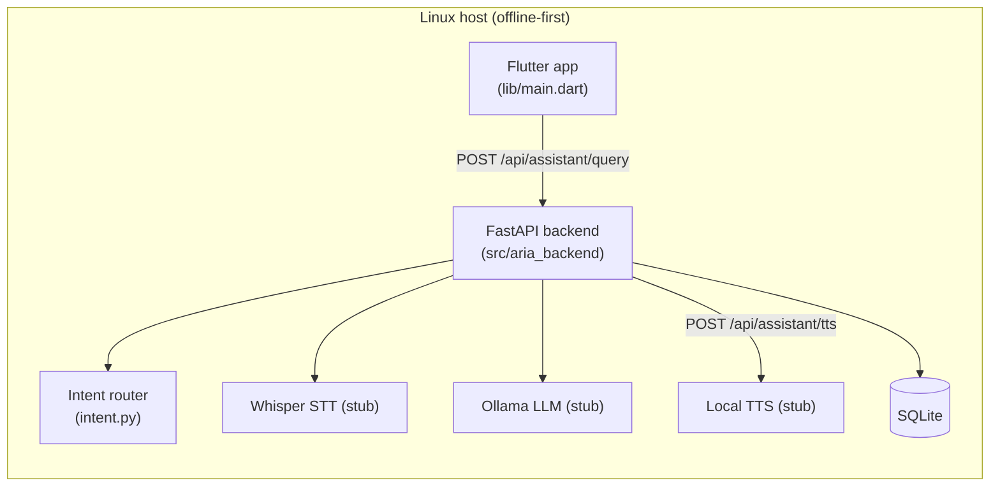

# ARIA — Voice Assistant for Linux Desktop/Server

> Offline-first, privacy-respecting voice assistant with a Flutter companion app and a Python FastAPI orchestration backend.

[](#testing)
[](./LICENSE)
[](./backend)
[](./backend)
[](./mobile)

## Overview

ARIA ("Assistant Runtime for Interactive Actions") is a voice assistant designed to run on a Linux
desktop or headless server. The heavy lifting (speech-to-text, intent resolution, text-to-speech and
local LLM inference) happens **on the machine**, so no audio ever leaves the device by default.

This repository is a **functional scaffold**: the backend is fully runnable and tested, while the
Flutter app provides a real entry point and a single assistant screen that you can build on.

## Problem & Solution

**Problem.** Cloud voice assistants require a network round-trip, ship private audio to third
parties, and stop working the moment connectivity drops.

**Solution.** ARIA runs the recognition and reasoning pipeline locally:
Whisper for STT, Ollama for the LLM, an on-device TTS engine, and a small deterministic intent
router for fast, testable command handling. The network is optional, not mandatory.

## Tech Stack

| Layer        | Technology                                                        |
| ------------ | ----------------------------------------------------------------- |
| Mobile UI    | Flutter (Dart)                                                     |
| Backend      | Python 3.11+, FastAPI, Uvicorn, Pydantic v2                        |
| Speech-to-text | Whisper (faster-whisper / whisper.cpp) — referenced, stubbed here |
| Text-to-speech | Local TTS engine (piper / espeak-ng) — referenced, stubbed here   |
| Reasoning    | Local LLM via Ollama — referenced, stubbed here                    |
| Storage      | SQLite (transcript + command history)                             |
| Tooling      | pytest, ruff, Docker, GitHub Actions                               |

## Architecture



App ↔ backend flow: the Flutter screen captures a transcript, sends it to the backend, the backend
resolves an intent (or falls back to the local LLM), and returns a reply plus optional audio
metadata for playback.

## Project Structure

```
mov-01-voice-linux-assistant/
├── backend/
│   ├── pyproject.toml
│   ├── src/aria_backend/
│   │   ├── __init__.py
│   │   ├── main.py        # FastAPI app: /health, /api/assistant/*
│   │   └── intent.py      # phrase -> action router
│   └── tests/
│       ├── test_api.py
│       └── test_intent.py
├── mobile/
│   ├── lib/main.dart      # single assistant screen (mic button + transcript)
│   └── pubspec.yaml
├── docs/
│   ├── architecture.md
│   └── adr/0001-initial-architecture.md
├── Dockerfile
├── docker-compose.yml
└── .github/workflows/ci.yml
```

## Getting Started

### Backend — local

```bash
cd backend
python -m venv .venv && source .venv/bin/activate
pip install -e ".[dev]"
uvicorn aria_backend.main:app --reload --port 8000
# health check
curl http://localhost:8000/health
```

### Backend — Docker

```bash
cp .env.example .env
docker compose up --build
```

### Mobile app

The Flutter app is a scaffold and is **not built in CI**:

```bash
cd mobile
flutter pub get
flutter run            # requires a connected device/emulator
```

## Configuration

| Variable             | Default                  | Description                                        |
| -------------------- | ------------------------ | -------------------------------------------------- |
| `ARIA_HOST`          | `0.0.0.0`                | Bind address for the API.                          |
| `ARIA_PORT`          | `8000`                   | Bind port for the API.                             |
| `ARIA_LOG_LEVEL`     | `info`                   | Uvicorn log level.                                 |
| `ARIA_DB_PATH`       | `./aria.db`              | SQLite file for transcript history.                |
| `ARIA_OLLAMA_URL`    | `http://localhost:11434` | Local Ollama endpoint (stub by default).           |
| `ARIA_WHISPER_MODEL` | `base`                   | Whisper model size used by the STT adapter.        |
| `ARIA_ALLOW_REMOTE`  | `false`                  | If `false`, only loopback clients are trusted.     |

Secrets are never committed: `.env` is git-ignored and `.env.example` documents the contract.

## API / Usage

| Method | Path                    | Description                                      |
| ------ | ----------------------- | ------------------------------------------------ |
| GET    | `/health`               | Liveness probe. Returns `{"status": "ok"}`.      |
| POST   | `/api/assistant/query`  | Resolve a transcript to an intent + reply.       |
| POST   | `/api/assistant/tts`    | Return placeholder speech-audio metadata.        |

```bash
curl -X POST http://localhost:8000/api/assistant/query \
  -H "Content-Type: application/json" \
  -d '{"transcript": "what time is it"}'
# {"action":"get_time","reply":"...","confidence":0.9}
```

## Testing

```bash
cd backend
pip install -e ".[dev]"
pytest -q
ruff check .
```

## Quality Standards

- **Testing** — intent routing and the HTTP surface are covered by unit tests with `pytest`.
- **CI/CD** — GitHub Actions lints (ruff) and tests on every push/PR.
- **Security** — configuration only via env vars; remote clients rejected unless explicitly enabled;
  all request bodies validated with Pydantic.
- **Performance** — intent routing is O(number of patterns) and runs before any model call, so common
  commands answer in microseconds; LLM calls are only a fallback.
- **UX** — one-thumb mic control, always-visible transcript, clear "listening/thinking" states.
- **Documentation** — README, `docs/architecture.md`, and an ADR describe the offline-first design.

## Roadmap

- [ ] Wire real `faster-whisper` STT adapter behind the existing stub interface.
- [ ] Add Ollama-backed LLM fallback with streaming responses.
- [ ] Persist transcripts to SQLite and expose a history endpoint.
- [ ] On-device wake-word detection in the Flutter app.
- [ ] Package as a systemd user service for headless servers.
